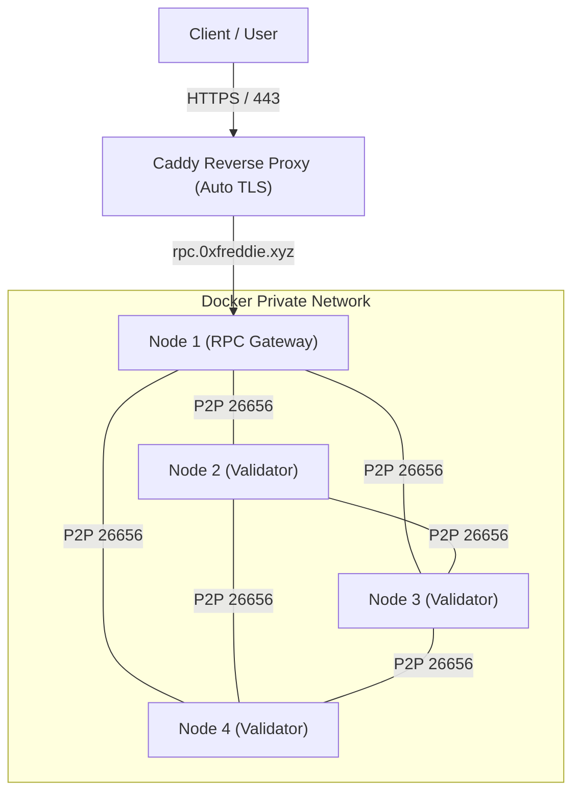

# CHORD (`chord-go`)

> **ZK-Friendly On-Demand BFT App-Chain Node Client in Go**

[](https://goreportcard.com/report/github.com/ghks18g/chord-go)
[](https://golang.org)
[](https://opensource.org/licenses/MIT)

---

## 1. 개요 (Overview)

`chord-go`는 영지식 증명(ZK-Proof) 친화적인 상태 머신과 온디맨드 합의 메커니즘을 결합한 L1 독립 앱체인 **CHORD**의 공식 Go 구현체입니다.

- **Chain Name**: **CHORD**
- **Native Token**: **CHOR**
- **Cosmos Chain ID**: `chord_7613-1`
- **EVM Chain ID**: `7613` (EIP-155)
- **State Commitment**: 256 깊이의 Poseidon-based Sparse Merkle Tree (SMT)
- **Consensus**: 온디맨드 4-노드 BFT 합의 (Snowman 스타일, `create_empty_blocks = false`)

---

## 2. 아키텍처 핵심 (Core Architecture)

### 2.1 네트워크 및 노드 토폴로지


### 2.2 핵심 특징 (Key Features)
1. **Poseidon-based SMT (ZK 친화적 상태 트리)**
   - 소수 유한체($\mathbb{F}_p$) 대수 순열 해시인 Poseidon을 사용하여 R1CS 제약식을 99% 이상 절감 (~240 constraints).
   - 단일 머클 경로로 특정 계정/스토리지의 **비존재 증명(Non-membership Proof)** 지원.
2. **EVM 서명 호환성 (책임의 분리)**
   - **EIP-712**: Keccak-f 기반 구조화 데이터 서명 지원으로 MetaMask 등 기존 지갑과 100% 호환.
   - **EIP-1271**: `isValidSignature`를 통해 스마트 계정의 ZK 증명 검증을 네이티브 지원.
3. **온디맨드 4-노드 BFT 합의**
   - $N=4, f=1$ BFT 결함 허용 (3/4 정족수).
   - `create_empty_blocks = false`: 트랜잭션이 없을 때는 CPU 점유율 0% 및 디스크 쓰기 0바이트 유지.
   - 트랜잭션 인입 시 수백 ms 이내 즉시 완결(Sub-second Finality).
4. **188GB 영속 디스크 관리 (State Bloat 방어)**
   - 4-Tier Pruning 적용으로 2년 연속 구동 시에도 체인 점유 용량 3~5GB 캡핑.

---

## 3. 디렉터리 구조 (Directory Structure)

```text
chord-go/
├── cmd/
│   ├── chordd/               # L1 노드 및 밸리데이터 데몬
│   └── chordcli/             # 트랜잭션 쿼리 및 ZK 증명 조회 CLI
├── pkg/
│   ├── types/                # Block, Transaction, Header, Genesis 코어 타입
│   ├── crypto/
│   │   ├── poseidon/         # BN254 유한체 Poseidon 해시 함수
│   │   └── signature/        # EIP-712 및 EIP-1271 서명 검증기
│   ├── store/
│   │   └── smt/              # 256 깊이의 Poseidon-based Sparse Merkle Tree
│   ├── vm/                   # EVM 가상머신 인터프리터 및 ZK 프리컴파일
│   ├── abci/                 # ABCI++ 인터페이스 (Prepare/Process/Finalize/Commit)
│   ├── bft/                  # 온디맨드 4-노드 BFT 합의 엔진
│   ├── app/                  # BaseApp 상태 머신 코디네이터
│   └── rpc/                  # CometBFT RPC 및 EVM JSON-RPC 통합 서버
└── docker/
    ├── Dockerfile            # 멀티스테이지 Go 빌드 도커파일
    └── docker-compose.yml    # 4-노드 BFT 클러스터 로컬 기동
```

---

## 4. 빌드 및 테스트 (Build & Test)

### 4.1 단위 테스트 실행
```bash
go test -v ./...
```

### 4.2 로컬 빌드
```bash
go build -o bin/chordd ./cmd/chordd
go build -o bin/chordcli ./cmd/chordcli
```

### 4.3 노드 기동
```bash
./bin/chordd --port=8545
```

---

## 5. 라이선스 (License)
MIT License.
