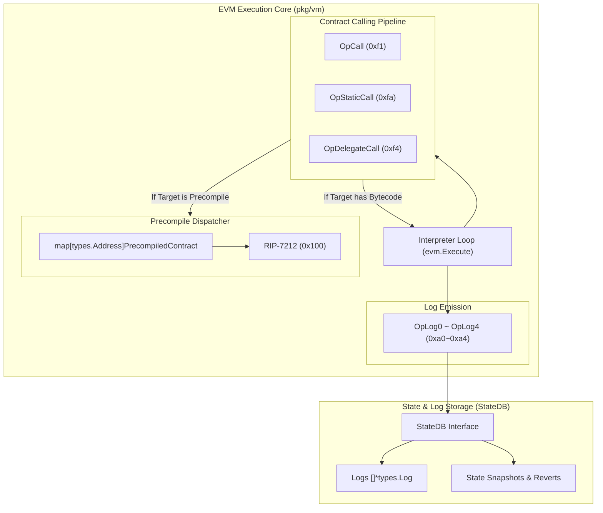

# Specification: chord-go EVM Engine Architecture & RIP-7212 Integration

> [!IMPORTANT]
> **표준 EVM 클라이언트(Geth / Avalanche-go Coreth) 아키텍처 준수 원칙**
> 본 명세는 임의의 편법(임시 if문, 수동 하드코딩)을 절대 금지하며, 이더리움 표준 클라이언트(`go-ethereum`) 및 아발란체 EVM 엔진(`avalanchego/coreth`)의 **모범 참조 아키텍처(Reference Architecture)**를 엄격히 준수하여 작성되었습니다.
> 작업자는 본 명세의 구조적 설계를 바탕으로 EVM의 콜/로그/프리컴파일 파이프라인을 체계적으로 구현해야 합니다.

---

## 1. 개요 및 모범 참조 아키텍처 (Geth / Coreth Pattern)

EVM에서 스마트 컨트랙트 간의 상호작용과 이벤트 처리는 아래 3개의 핵심 축으로 구동됩니다.



---

## 2. 세부 아키텍처 및 구현 가이드 (Geth/Coreth 기준)

### Architecture Component A. 프리컴파일 표준 인터페이스 (`pkg/vm/precompiled.go`)
Geth의 `core/vm/contracts.go` 구조를 그대로 채택합니다:

```go
// PrecompiledContract is the standard execution interface for native EVM precompiles.
type PrecompiledContract interface {
    RequiredGas(input []byte) uint64
    Run(input []byte) ([]byte, error)
}

// PrecompiledContracts maps native addresses (e.g., 0x100) to their handlers.
var PrecompiledContracts = map[types.Address]PrecompiledContract{
    // RIP-7212 secp256r1 P256VERIFY Precompile at 0x100
    types.HexToAddressMust("0x0000000000000000000000000000000000000100"): &RIP7212Precompile{},
}
```

---

### Architecture Component B. 컨트랙트 호출 옵코드 (`CALL`, `STATICCALL`, `DELEGATECALL`)

EVM 스택/메모리 규칙과 Geth의 `instructions.go` / `evm.go` 구현 기준을 명시합니다.

#### 1. 공통 콜 파이프라인 (Call Execution Flow)
- **Call Depth 제한:** `depth > 1024` 시 `ErrDepth` 반환 후 스택에 `0` 푸시.
- **상태 스냅샷 (Snapshot & Revert):**
  - 서브콜 시작 전 `snapshot := evm.StateDB.Snapshot()` 생성.
  - 서브콜 실패/Revert 시 `evm.StateDB.RevertToSnapshot(snapshot)` 수행하여 상태 롤백.
- **프리컴파일 우선 라우팅:**
  - 호출 대상(`to`)이 `PrecompiledContracts`에 등록된 주소인 경우, 바이트코드 로드 없이 즉시 `PrecompiledContract.Run(input)` 호출.

#### 2. 옵코드별 차이점 및 컨텍스트 규칙 (절대 혼동 금지)

| 옵코드 | OpCode | 스택 파라미터 | Context.Caller | Context.To (Storage) | Context.Value | 상태 변경 가능 여부 |
| :--- | :--- | :--- | :--- | :--- | :--- | :--- |
| **`CALL`** | `0xf1` | `gas, to, value, inOff, inSize, outOff, outSize` | 현재 컨트랙트 | 호출 대상(`to`) | 전달받은 `value` | 가능 (`isStatic = false`) |
| **`STATICCALL`** | `0xfa` | `gas, to, inOff, inSize, outOff, outSize` | 현재 컨트랙트 | 호출 대상(`to`) | `0` (송금 불가) | **불가 (`isStatic = true`)** |
| **`DELEGATECALL`** | `0xf4` | `gas, to, inOff, inSize, outOff, outSize` | **호출자의 Caller 유지** | **현재 컨트랙트 유지** | **호출자의 Value 유지** | 가능 (`isStatic` 상속) |

> [!CAUTION]
> **DELEGATECALL 주의사항 (프록시/스마트지갑 필수):**
> `DELEGATECALL`은 실행할 바이트코드는 대상(`to`)에서 가져오지만, **스토리지 읽기/쓰기(`SLOAD/SSTORE`)와 계정 주소(`ADDRESS`)는 반드시 현재 컨트랙트(Caller)의 상태**에서 일어납니다. ERC-4337 계정 및 모듈러 프록시가 동작하는 근간입니다.
> 
> **STATICCALL 쓰기 보호 (Write Protection):**
> `STATICCALL` 컨텍스트 내부에서 `SSTORE`, `CREATE`, `LOG0~LOG4` 등 상태를 바꾸는 옵코드가 실행되면 즉시 `ErrWriteProtection`을 발생시키고 Revert 처리해야 합니다.

---

### Architecture Component C. 이벤트 로깅 옵코드 (`LOG0` ~ `LOG4`) 및 영수증 파이프라인

Geth의 `opLog` 및 `StateDB.AddLog` 메커니즘을 적용하여 기존의 수동 하드코딩 로그 생성을 완전히 대체합니다.

#### 1. 옵코드 스펙 (`0xa0` ~ `0xa4`)
- `LOG0` (토픽 0개) ~ `LOG4` (토픽 4개)
- **스택 팝:**
  1. `offset`: 메모리 데이터 시작 위치
  2. `size`: 메모리 데이터 길이
  3. `topic0 ~ topicN`: $N$개의 32바이트 토픽 값 ($N \in [0, 4]$)
- **가스 계산:** $375 + 375 \times N + 8 \times \text{size} + \text{메모리 확장 가스}$
- **실행:**
  - `isStatic` 모드인 경우: `ErrWriteProtection` 반환.
  - 메모리 복사: `data := memory.GetCopy(offset, size)`
  - 로그 생성 및 StateDB 버퍼 적재:
    ```go
    log := &types.Log{
        Address:     evm.Context.To,
        Topics:      topics,
        Data:        data,
        BlockNumber: uint64(evm.Context.BlockNumber),
    }
    evm.StateDB.AddLog(log)
    ```

#### 2. 트랜잭션 영수증(`TxReceipt`)과의 연동
- 트랜잭션 실행 완료 시, `StateDB.GetLogs(txHash)`에서 수집된 로그 슬라이스를 가져와 `receipt.Logs`에 그대로 대입.
- **결과:** `server.go` 내부의 `if lowerTo == Faucet` 같은 수동 로그 생성 코드가 완전히 불필요해집니다.

---

### Architecture Component D. `StateDB` 인터페이스 확장 (`pkg/vm/state.go`)

Geth 스타일의 롤백 및 로그 버퍼링을 위해 `StateDB` 인터페이스에 아래 메서드를 추가합니다:

```go
type StateDB interface {
    // 기존 메서드 (GetBalance, GetNonce, GetCode 등) 유지...
    
    // 롤백 지원 (CALL 실패 시 서브콜 상태 복원용)
    Snapshot() int
    RevertToSnapshot(id int)
    
    // 로그 버퍼링 지원 (LOG0~LOG4 및 영수증 연계용)
    AddLog(log *types.Log)
    GetLogs() []*types.Log
    ClearLogs()
}
```

---

## 3. 단계별 작업 순서 (Implementation Roadmap)

### Phase 0: 사전 리팩토링 (기존 하드코딩 분리)
1. `pkg/app/app.go`의 `ExecuteTransaction` 내 Faucet/Forwarder 인라인 `if` 분기를 `pkg/app/hooks/` 시스템 훅으로 분리.
2. `pkg/rpc/server.go`의 인라인 로그 조립 코드를 `log_enricher.go`로 분리.
3. `go test ./...` 100% 통과 확인.

### Phase 1: EVM 엔진 고도화 (CALL / LOG / StateDB)
1. `pkg/vm/state.go`: `Snapshot`, `RevertToSnapshot`, `AddLog`, `GetLogs` 구현.
2. `pkg/vm/opcodes.go`: `CALL`, `STATICCALL`, `DELEGATECALL`, `LOG0` ~ `LOG4` OpCode 및 가스 상수 추가.
3. `pkg/vm/evm.go`:
   - `CALL`, `STATICCALL`, `DELEGATECALL` 핸들러 구현 (콜 깊이 체크, 스냅샷 롤백, 프리컴파일 확인).
   - `LOG0` ~ `LOG4` 핸들러 구현 (메모리 추출 및 `StateDB.AddLog`).
4. `pkg/vm/precompiled.go`: `PrecompiledContract` 표준 인터페이스 선언 및 디스패처 작성.

### Phase 2: RIP-7212 (P256VERIFY) 프리컴파일 연동
1. `pkg/vm/rip7212.go`:
   - `PrecompiledContract` 인터페이스 구현체(`RIP7212Precompile`).
   - NIST P-256 (`crypto/elliptic.P256()`, `crypto/ecdsa`) 160바이트 검증.
   - 3,450 Gas 고정 소모.
2. `PrecompiledContracts` 맵에 `0x00...0100` 등록.

### Phase 3: RPC 레이어 표준화 (`pkg/rpc/server.go`)
1. `eth_call`: `to`가 프리컴파일 또는 컨트랙트일 때 EVM 디스패처를 통해 실행 결과 반환.
2. `eth_sendRawTransaction`: 트랜잭션 영수증 생성 시 `StateDB.GetLogs()`를 연결하여 실제 온체인 로그가 반환되도록 표준화.

---

## 4. 테스트 케이스 및 검증 기준 (Definition of Done)

### 필수 테스트 항목
1. **`pkg/vm/call_test.go` (신규):**
   - [ ] `CALL`: 호출자 간 송금 및 서브 호출 상태 변경 확인.
   - [ ] `STATICCALL`: 내부에서 `SSTORE` 시도 시 `ErrWriteProtection` 발생 및 롤백 확인.
   - [ ] `DELEGATECALL`: 대상 코드 실행 시 스토리지 변경 대상이 원래 컨트랙트 주소인지 확인.
2. **`pkg/vm/log_test.go` (신규):**
   - [ ] `LOG1` ~ `LOG4`: 메모리 데이터와 토픽이 `StateDB.GetLogs()`에 정확히 적재되는지 확인.
3. **`pkg/vm/rip7212_test.go`:**
   - [ ] 유효한 P-256 서명 벡터 160바이트 입력 시 `0x00...01` 반환 확인.
   - [ ] 위조 서명 / 곡선 이탈 좌표 입력 시 빈 슬라이스 반환 확인.
   - [ ] `STATICCALL`을 통해 `0x100` 주소를 호출하여 서명 검증이 통과하는 E2E 컨트랙트 호출 테스트.

### 통과 기준 (Pass Condition)
```bash
export PATH="/Users/freddie/go/pkg/mod/golang.org/toolchain@v0.0.1-go1.26.0.darwin-arm64/bin:$PATH"
cd /Users/freddie/Documents/freddie/chord-go

# 1. EVM 콜/로그/프리컴파일 단위 테스트 100% 통과
go test -v ./pkg/vm

# 2. 전체 패키지 회귀 테스트 100% 통과 (Exit code: 0)
go test ./...

# 3. 데몬 빌드 검증
go build -o bin/chordd ./cmd/chordd
```
위 테스트가 모두 통과하고, EVM이 Geth 표준의 Call/Log/Precompile 파이프라인으로 정돈되었을 때 작업 완료로 승인합니다.
